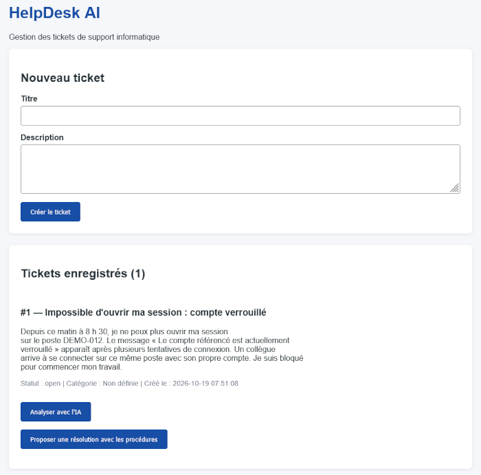
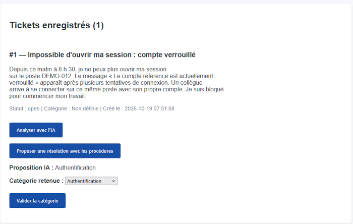
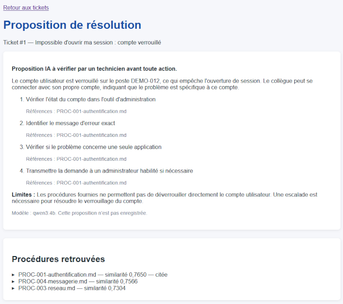

# Assistant de support informatique avec IA locale type RAG

_HelpDesk AI_ est un prototype d'assistant de support informatique intégrant un pipeline RAG _Retrieval-Augmented Generation_) local, développé en PHP avec LLPhant et Ollama. Il recherche des procédures par similarité sémantique et génère des propositions de résolution avec références documentaires, à vérifier par un technicien.

Ce prototype utilise des données fictives en exécution locale et ne constitue pas un projet prêt à être déployé en production.

Ce projet implémente les trois étapes caractéristiques de cette approche :

1. Indexation : les procédures sont transformées en embeddings.
2. Recherche : l'application retrouve les procédures les plus proches du ticket par similarité cosinus.
3. Génération augmentée : ces procédures sont transmises au modèle pour produire une proposition de résolution avec des références.

La classification des tickets est une fonctionnalité IA complémentaire ; c'est la génération fondée sur les procédures qui constitue le RAG.

> La notion de [RAG](https://fr.wikipedia.org/wiki/G%C3%A9n%C3%A9ration_%C3%A0_enrichissement_contextuel) sur Wikipédia.

## Fonctionnalités disponibles

- Création et consultation de tickets d'assistance utilisateur informatique.
- Proposition d'une catégorie par le modèle d'IA Qwen3, parmi six catégories autorisées.
- Correction et validation humaine de la catégorie.
- Recherche dans la documentation de l'entreprise : procédures de résolution des problèmes informatique.
- Génération d'une proposition fondée sur les trois procédures les plus proches (avec un résumé, jusqu'à cinq étapes référencées et des limites éventuelles).
- Affichage des procédures retrouvées pour permettre la vérification des conseils.

La validation humaine (approche _Human in the loop_) actuelle concerne la catégorie. Les propositions de résolution sont affichées sans être enregistrées et sans modifier le ticket. L'application n'exécute aucune des actions proposées.

## Technologies et architecture

⚠️ L'installation et l'exécution locale nécessite l'utilisation de la solution de conteneurisation _Docker_.

| Composant | Utilisation |
| --- | --- |
| PHP + Apache | Pages rendues côté serveur, services PHP et templates partagés |
| LLPhant / Ollama / Qwen | IA/LLM : classification et génération |
| LLPhant / `nomic-embed-text` | Vectorisation (Embeddings) des documents (procédures) |
| Composer | Chargement PSR-4 et commandes de contrôle |
| MySQL | Base de données |
| Qdrant | Stockage des vecteurs et recherche des procédures par similarité cosinus |
| Docker | Exécution locale (conteneurs) |
| Git / Github / Github Actions | Gestion de versions, CI/CD (tests et déploiement) |

En local, l'application est disponible sur l'url [http://localhost:8081](http://localhost:8081/). La base de données est gérable via l'interface phpMyAdmin sur l'url [http://localhost:8082](http://localhost:8082/).

## Axes d'amélioration

### Sécurisation

- Sécurisation :
  - authentification et gestion de rôles
  - protection des accès (dossiers, documents, base de données).
- Mesure de la performance du modèle IA et des réponses :
  - Enregistrer, corriger et valider les résolutions, avec un historique.
  - Évaluer la pertinence des réponses sur davantage d'incidents et renforcer la résistance aux injections de prompts.
  - Améliorer la recherche : actuellement un vecteur par fichier, sans seuil minimal de similarité ni découpage en passages.
- Gérer les traitements IA longs : appels synchrones, sans file d'attente ni limitation de débit.

## Utilisation / Ecrans

### Ecran 1 : Saisie et liste des tickets

Ecran d'accueil de l'application :

### Ecran 2 : Analyse IA

Ecran obtenu via le bouton _Analyser avec l'IA_ de l'écran 1 :

La liste déroulante _Catégorie retenue_ permet au technicien helpdesk de modifier la proposition retenue par l'IA (sur laquelle la liste est prépositionnée), via le bouton _Valider la catégorie_.

### Ecran 3 : Proposition de résolution

Ecran obtenu via le bouton _Proposer une résolution avec les procédures_ : l'IA recheche dans les documents (procédures techniques) et génère une réponse pour la résoultuon du problème :

## Documentation

- [Corpus documentaire](documents/README.md) : 17 procédures, dont 12 diagnostics techniques détaillés.
- [Guide utilisateur](README-USER.md) : parcours, contrôles et limites.
- [Guide développeur](README-DEV.md) : installation, configuration, architecture et tests.
- [Intégration Qdrant](documents/QDRANT.md) : installation, fonctionnement et vérifications pas à pas.
- [Exemples de tickets](README-EXAMPLES.md) : dix demandes fictives et vérifications manuelles.
